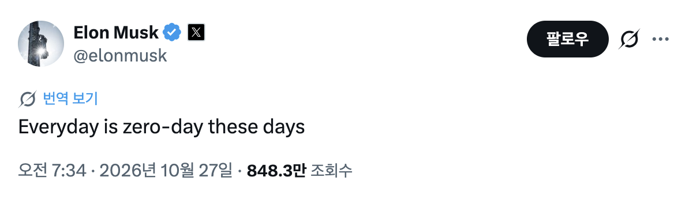

일론 머스크가 X에 "요즘은 매일이 제로데이"라고 썼다.

이 글을 보고 미래의 네트워크 생태계는 어떻게 변할지, 내 나름 상상의 나래를 펼쳐봤다.

## 매일이 제로데이
공격용 AI는 밤새 수많은 프로그램의 취약점을 찾아내고, 새로운 공격 코드를 만든다. 사람이 취약점을 분석하고 대응책을 배포할 때쯤이면 이미 다른 공격이 시작되어 있다. 이제는 매일이 제로데이다.

## 게이트웨이 AI
서로 다른 로컬 AI가 각 게이트웨이에 탑재되어 모든 패킷을 검사한다.
AI는 패킷의 내용을 하나씩 보는 데 그치지 않는다. 여러 패킷을 다시 조합해 파일과 요청을 확인하고, 누가 어느 서버에 보냈는지, 과거 통신 이력은 어땠는지 까지 검사한다.

신뢰할 수 있는 일부 게이트웨이가 검문소로서 내용을 복호화해 검사한 뒤 다시 암호화한다. 즉 안전하게 통신하려면, 통신 내용을 검문소에 공개해야 한다. 이로서 검문소의 감시와 권력이 집중된다.

## 새로운 프로토콜
AI가 검사하는 동안 패킷은 게이트웨이를 떠나지 못한다. 지연 시간은 치솟고 처리량은 급락한다. 새로운 네트워크 생태계에 맞춰 새로운 프로토콜이 나타났다. 정보는 최대한 가볍게, 추론은 쉽게, 한 번에 최대한 많은 데이터를 넣도록 지향한다.

## 느슨하게 독립된 네트워크
현재에도 독립적으로 운영되는 네트워크들이 연결되어 인터넷을 이룬다. 하지만 미래에는 서로 다른 지역과 조직을 신뢰하는 비용이 너무 커져, 각 지역이 내부에서 최대한 독립적으로 작동하고 외부와는 엄격한 검문을 거쳐서만 통신하게 된다.

국가 간에는 여러 해저 케이블과 통신 회선이 있지만, 각 국가는 대형 사고 이후의 규제 및 책임 소재, 관리 비용 때문에 관문을 소수로 통제했다.

이 관문은 단순한 검문소가 아니라 데이터가 국경을 넘기 위해 통과해야 하는 세관이 되었다.

## 시나리오
1. AI를 이용한 공격이 빨라지고, 취약점 대응이 필요한 시스템의 수도 계속 늘어난다.
2. 대규모 사고를 겪은 기업과 국가는 외부에서 들어오는 데이터를 통과 전에 검사하기 시작한다.
3. 검사에는 계산 자원과 시간이 필요하고, 모든 통신을 같은 수준으로 검사하기 어려워진다.
4. 자주 사용하는 자료와 서비스를 지역 내부에 복제해 외부 통신을 줄인다.
5. 지역 간 통신은 소수의 고성능 보안 관문으로 집중된다.
6. 관문을 가능한 빠르게 통과하기 위한 통신 규격이 자리 잡는다.
7. 지역 안에서는 빠르지만, 지역 밖과는 느리고 비싸며 검열과 감시 가능성이 있는 인터넷이 만들어진다.

## 결과
인터넷은 끊어지지 않았다. 다만 모두가 서로를 의심하게 되면서, 연결을 유지하기 위한 검문이 연결 자체보다 중요해졌다.

사람들의 일상에서 인터넷 속도는 세기말 수준으로 퇴보하였다. 지구촌 리얼타임 온라인 게임은 사장되었으나, 리얼타임 게임 자체는 살아남았다. 같은 LAN 내부의 플레이어를 대상으로 하며, 전 세계의 오락실 사업은 두 번째 황금기를 맞이하였다.
